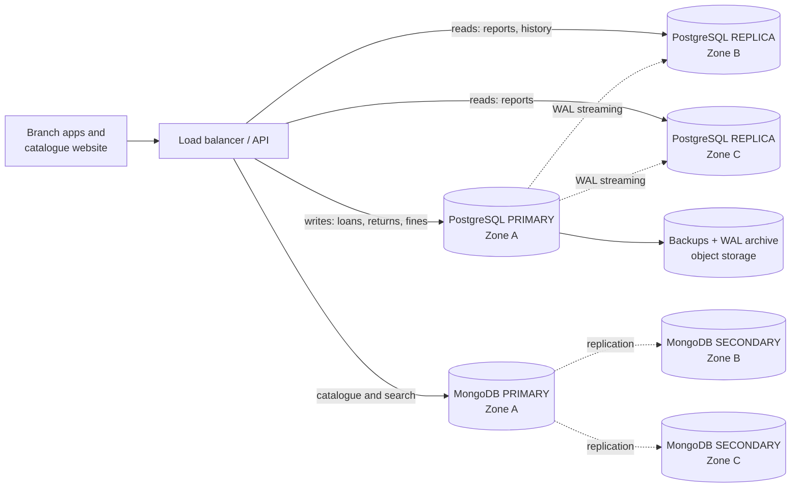

# CityLib: Distributed and Cloud Database Design

Scenario: CityLib grows from one branch to a regional network of 40 branches and 2 million members, with an online catalogue used day and night. This document explains how the databases from Portfolios 1-4 would be distributed, and where the hands-on exercises in this folder fit.

## 1. Target Architecture

**Polyglot split (from Portfolio 4):** PostgreSQL is the system of record for members, loans and fines (strict consistency). MongoDB serves the flexible, read-heavy catalogue.

## 2. Replication

| Aspect | PostgreSQL | MongoDB |
|---|---|---|
| Mechanism | Streaming replication of the write-ahead log (WAL) to hot standbys | Replica set: primary plus secondaries replaying the oplog |
| Hands-on evidence | `02_replication_postgres.sh` | `03_mongo_replicaset.sh` |
| Topology | 1 primary, 2 replicas in separate availability zones | 1 primary, 2 secondaries (3 voting members) |
| Writes | Primary only | Primary only |
| Reads | Replicas for reports and history (may be slightly stale) | Secondaries via read preference, where staleness is acceptable |
| Failover | Promotion of a replica (manual with `pg_ctl promote`, or automatic with Patroni or a managed cloud service) | **Automatic election** of a new primary, typically in seconds |
| Replication mode | Asynchronous by default: fast, but a crash can lose the last few commits. `synchronous_commit` with a synchronous standby gives zero data loss at the cost of write latency | Write concern `w:"majority"` makes a write durable on most members before it is acknowledged |

**Choice for CityLib:** loans and fines use a synchronous standby (or `w:majority` for any critical Mongo write), because losing a confirmed loan is unacceptable. Reports and the catalogue tolerate asynchronous replicas.

## 3. Sharding and Partitioning

Sharding means splitting one logical dataset across several servers (horizontal scaling) when a single server can no longer hold or serve it. The hands-on exercise is `01_partitioning_sharding.sql`.

| Data | Shard / partition key | Reason |
|---|---|---|
| `loans` (PostgreSQL) | **Hash of `member_id`** | The dominant queries are per member ("my loans", "borrow a book"), so each hits exactly one shard. Hashing spreads rows evenly (about 25% each in the exercise) and avoids hot spots |
| `loans` archive | **Range on `loan_date`** (quarterly) | Old quarters can be detached, archived or dropped cheaply, and date-range reports read only the relevant partitions (partition pruning) |
| `books` (MongoDB) | Hashed `_id` | Even distribution, and ISBN/ID lookups are targeted |

**Trade-offs shown in the exercise:**
- Filtering on the shard key is a **targeted** query (one shard). Filtering on anything else is **scatter-gather** (all shards, results merged), which is slower and costs more as shards are added. A shard key must therefore match the main access pattern.
- Cross-shard operations (for example a report over all members) and cross-shard transactions are more expensive and complex.
- A poor key (for example `loan_date`, so all new loans hit the newest shard) creates a **hot shard**.
- `member_id` was chosen over `copy_id`, because the "can this member borrow?" check and the loan insert then stay on a single shard. Checking whether a *copy* is free is the cross-shard part, and in practice it is handled by routing copy lookups through the catalogue service.

In real deployment, each hash partition would live on a separate server using Citus (a PostgreSQL extension), foreign data wrappers, or a managed distributed SQL service. MongoDB provides native sharding (`sh.shardCollection`) with config servers and `mongos` routers.

## 4. Consistency and Availability (CAP / PACELC)

| Component | Priority | Behaviour during a network partition | Rationale |
|---|---|---|---|
| Loans and fines (PostgreSQL primary) | **Consistency (CP)** | Minority side stops accepting writes rather than risk two primaries (split brain) | A copy must never be lent twice, and fines must be accurate |
| Reports (PostgreSQL replicas) | Availability (AP-leaning) | Replicas keep answering reads, possibly slightly stale | A report a few seconds old is fine |
| Catalogue (MongoDB) | Availability with tunable consistency | Secondaries serve reads. Writes need a majority | Browsing must always work. An out-of-date "available" flag is tolerable because the real check happens at borrow time in PostgreSQL |

PACELC view: even with no partition, replication forces a **latency vs consistency** choice (reading from a replica is faster but may lag; reading from the primary is current). Replication lag was measured in `02_replication_postgres.sh` (step 8).

## 5. Availability and Disaster Recovery

| Measure | Design |
|---|---|
| Node failure | Replica promotion (PostgreSQL) or automatic election (MongoDB) |
| Zone failure | Primary and replicas spread over 3 availability zones |
| Data loss protection | Continuous WAL archiving gives point-in-time recovery (PITR), plus daily base backups |
| Targets (example) | RPO of seconds (synchronous standby), RTO of a few minutes |
| Testing | Failover drills (see the `promote` and `failover` modes in the scripts) |
| Maintenance | Rolling upgrades: upgrade replicas first, fail over, then upgrade the old primary |

## 6. Cloud Deployment Options

| Need | AWS | Azure | Google Cloud |
|---|---|---|---|
| Managed PostgreSQL with automatic failover | RDS or Aurora PostgreSQL (Multi-AZ) | Azure Database for PostgreSQL (zone-redundant HA) | Cloud SQL (HA) or AlloyDB |
| Read replicas | RDS/Aurora read replicas | Read replicas | Cloud SQL read replicas |
| Managed MongoDB | MongoDB Atlas, or DocumentDB (MongoDB-compatible) | MongoDB Atlas, or Cosmos DB for MongoDB | MongoDB Atlas |
| Backups and PITR | Automated backups plus PITR | Automated backups plus PITR | Automated backups plus PITR |
| Distributed SQL (sharding) | Aurora Limitless, or self-managed Citus | Azure Cosmos DB for PostgreSQL (Citus) | AlloyDB, Spanner (different API) |

**Recommended for CityLib:** managed PostgreSQL with Multi-AZ HA and 2 read replicas, plus MongoDB Atlas (3-node replica set), both in the same region across 3 zones. Considerations:
- **Managed vs self-hosted:** managed services remove patching, failover and backup work, at a higher price and with less low-level control.
- **Cost:** pay for replicas and cross-zone traffic, so size read replicas to actual load.
- **Security:** private networking, encryption at rest and in transit, least-privilege roles, audit logging. Member data (names, emails, phones) is personal data and may fall under data-protection law (for example the Nigeria Data Protection Act), which also affects which region may host it.
- **Data residency and latency:** choose a region near the branches. Add a cross-region read replica only if a second geography needs it.
- **Vendor lock-in:** standard PostgreSQL and MongoDB APIs keep migration options open, while proprietary variants (Aurora specifics, Cosmos DB) reduce them.

## 7. What was actually built and measured here

| Concept | Evidence in this repository |
|---|---|
| Range partitioning and pruning | `01_partitioning_sharding.sql`, sections A1-A3 |
| Hash sharding, even distribution, targeted vs scatter-gather | `01_partitioning_sharding.sql`, sections B1-B4 |
| PostgreSQL streaming replication, read-only replica, lag, failover | `02_replication_postgres.sh` |
| MongoDB replica set, replication, automatic election | `03_mongo_replicaset.sh` |
| Cloud, CAP and DR design | This document (a design discussion, not a deployed cloud environment) |
